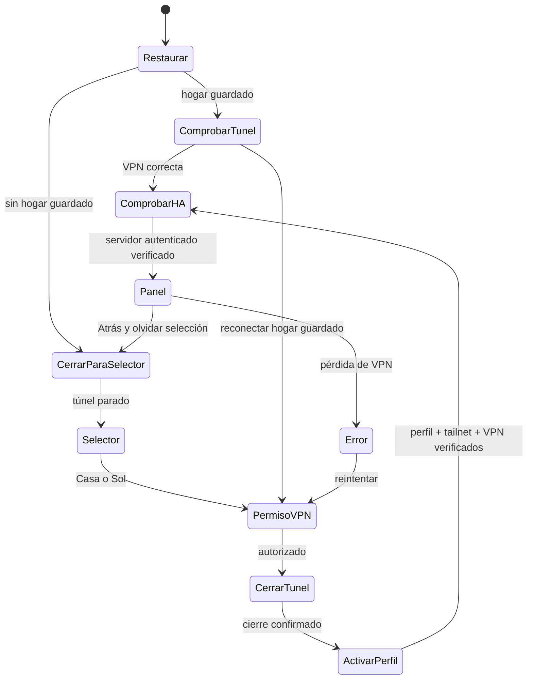

# Arquitectura de HATailAPK

## Decisión inicial

Una aplicación, un servicio VPN y dos viviendas persistentes. Android admite un único `VpnService` activo por usuario/perfil: [documentación oficial](https://developer.android.com/develop/connectivity/vpn). La prueba en el teléfono confirmó que los dos servidores HA son accesibles con la misma tailnet; el adaptador usa una sola identidad Tailscale y dos registros Companion independientes.

La raíz contiene la integración propia y referencias Git a los originales. `upstream/home-assistant-android` aporta Companion; `upstream/tailscale-android`, la adaptación Android/Go; `upstream/tailscale` fija el motor compatible. `tools/prepare-integrated.py` genera worktrees en `.integration/`, convierte el cliente Android en biblioteca y permite que la aplicación Hilt de Companion herede la inicialización Tailscale.

## Adaptador Casa/Sol

`integration/companion/` contiene la pantalla Compose y un adaptador real. Usa las APIs internas del cliente Tailscale, verifica perfil/tailnet/servicio y conserva la selección cifrada. Casa conserva su registro; Sol guarda otra URL e ID de servidor. Companion mantiene autenticación, registro y frontend originales, con un paquete propio para coexistir con las aplicaciones oficiales.

El registro inicial crea una fila OAuth antes de tener un webhook. `HatailHomeAssistantRepository` espera un registro completo antes de consultar `getConfig`; los eventos de base de datos no deben cancelar ese alta intermedia. Solo después de la consulta autenticada se fija el servidor. La URL privada se asocia a la VPN como dirección interna; HTTP fuera de la red interna y las rutas cloud quedan deshabilitados.

El adaptador aún debe unificarse con todos los efectos de `ConnectionMachine`. Las pruebas del núcleo no sustituyen las pruebas del adaptador ni del teléfono. Antes de mostrar el panel, activa el servidor HA registrado de la vivienda elegida y crea una navegación nueva para evitar mostrar el panel anterior.

## Cambio de vivienda

La selección se recuerda entre aperturas, incluso si el proceso Android termina. En arranque o regreso al primer plano, el host carga la referencia guardada y envía `Event.Resume`. Si hay un hogar, inspecciona la VPN existente y vuelve a verificar HA sin reiniciar un túnel correcto ni perder la navegación de Companion. Si falta su VPN, reconecta ese mismo hogar. Nunca cambia automáticamente al otro.

Solo Atrás abandona el hogar: el host envía `Event.Disconnect`, borra la selección persistida, cierra el panel y espera la parada confirmada del túnel para mostrar Casa/Sol. Un cierre de proceso o el envío a segundo plano no generan esa desconexión. Un error de red mantiene el hogar para reintentar; no abre el selector. La selección de otra casa se rechaza hasta completar la salida.

`ConnectionMachine` produce estados y efectos sin acceso a red. `HomeSelectorView` representa esos estados y comunica la elección al host. No contiene un cliente VPN ficticio ni abre un navegador externo.

Cada vivienda relaciona `HomeId`, ID de login Tailscale, sufijo MagicDNS, URL HA y referencia a un servidor registrado en Companion. En la instalación probada, ambas referencias Tailscale apuntan al mismo perfil. El ID HA es una referencia local, no una identidad criptográfica: la comprobación real debe usar el cliente autenticado de esa instancia y la ruta VPN seleccionada. Un HTTP 200 no basta. No seguir redirecciones hacia destinos distintos ni volver automáticamente a Cloudflare.

## Contrato obligatorio del adaptador pendiente

- Procesar eventos y efectos en una cola serial. Ejecutar las operaciones del motor VPN en orden; ignorar callbacks antiguos no impide por sí solo una mutación tardía del backend.
- `CancelBefore` invalida tareas anteriores, deadlines, sondas y navegación pendiente. Debe cancelar o esperar operaciones nativas anteriores antes de cambiar de perfil.
- `RememberHome` guarda la referencia seleccionada de forma durable; `ForgetHome` la elimina al salir con Atrás. Ambas operaciones pertenecen a la cola serial y respetan el intento vigente. Un fallo de almacenamiento impide avanzar. No guardar credenciales en ellas.
- `GuardHomeAssistant` oculta temporalmente el panel y suspende sus peticiones durante la revalidación, conservando su navegación y sesión. `InspectTunnel` devuelve una identidad observada, incluso si la VPN está parada, usando `TunnelReady`; no solicita todavía un cambio de perfil.
- `CloseHomeAssistant` cierra el panel y suspende conexiones HA que pudieran usar la vivienda anterior antes de cualquier cambio de túnel.
- `PrepareVpn` usa el consentimiento Android mediante `VpnService.prepare()`. Solo emitir `TunnelStopped` tras confirmar el cierre real.
- `Activate` cambia el perfil, arranca el motor y espera tanto su estado `Running` como el túnel establecido. Emitir `TunnelReady` con datos observados del motor, nunca con valores copiados de la configuración.
- `VerifyServer` verifica la ruta y conexión autenticada del HA registrado. `OpenHomeAssistant` debe volver a comprobar el intento vigente antes de navegar.
- Usar un deadline inicial de 30 segundos, ajustable tras pruebas. Traducir errores sin registrar secretos; mantener observación de permisos, identidad y estado del túnel después de conectar.
- No asociar `onStop`, `onDestroy`, Inicio ni segundo plano con `Disconnect`. El host intercepta Atrás al salir del hogar. Tras una salida fallida se muestra error y reintento de parada, nunca el selector sobre un túnel aún sin cerrar.

El cliente upstream expone `profiles`, `currentProfile`, `switchProfile` y `status` en [Client.kt](https://github.com/tailscale/tailscale-android/blob/4aae7d26d1918b9264236b4ddf77060f8280ff5f/android/src/main/java/com/tailscale/ipn/ui/localapi/Client.kt). Son APIs internas del cliente, no un contrato de control entre APK independientes. `App`, el servicio y el binding Go requieren una adaptación conjunta; no basta con copiar el manifiesto.

## Notificaciones

Ambos HA responden desde la misma tailnet en la prueba del teléfono, pero eso no demuestra la entrega de alertas con pantalla apagada. Evaluar el transporte push disponible en la variante minimal, el comportamiento en segundo plano y los cambios de red. Atrás detiene la VPN por requisito de navegación; las alertas locales de ambas viviendas pueden quedar interrumpidas hasta volver a entrar.

No realizar rotaciones periódicas de VPN como sustituto de alertas fiables. Las credenciales y las claves quedan en los almacenes seguros de los clientes; no en el modelo ni en el JSON de ejemplo. La distribución de una APK propia también requiere resolver firma, identidad de aplicación y credenciales push propias cuando correspondan.
