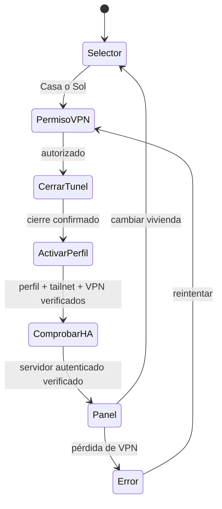

# Arquitectura de HATailAPK

## Decisión inicial

Una aplicación, un servicio VPN y dos perfiles persistentes. Android admite un único `VpnService` activo por usuario/perfil: [documentación oficial](https://developer.android.com/develop/connectivity/vpn). No se ejecutarán dos clientes Android paralelos.

La raíz contiene la integración propia y referencias Git a los originales. `upstream/home-assistant-android` será la base funcional de Companion; `upstream/tailscale-android` aporta la adaptación Android/Go, y `upstream/tailscale` fija el motor compatible. Aún no se han fusionado ni convertido sus módulos en una aplicación única.

## Cambio de vivienda

`ConnectionMachine` produce estados y efectos sin acceso a red. `HomeSelectorView` representa esos estados y comunica la elección al host. No contiene un cliente VPN ficticio ni abre un navegador externo.

Cada perfil relaciona `HomeId`, ID de login Tailscale, sufijo MagicDNS, URL HA y referencia a un servidor registrado en Companion. El ID HA es una referencia local, no una identidad criptográfica: la comprobación real debe usar el cliente autenticado de esa instancia y la ruta VPN seleccionada. Un HTTP 200 no basta. No seguir redirecciones hacia destinos distintos ni volver automáticamente a Cloudflare.

## Contrato obligatorio del adaptador pendiente

- Procesar eventos y efectos en una cola serial. Ejecutar las operaciones del motor VPN en orden; ignorar callbacks antiguos no impide por sí solo una mutación tardía del backend.
- `CancelBefore` invalida tareas anteriores, deadlines, sondas y navegación pendiente. Debe cancelar o esperar operaciones nativas anteriores antes de cambiar de perfil.
- `CloseHomeAssistant` cierra el panel y suspende conexiones HA que pudieran usar la vivienda anterior antes de cualquier cambio de túnel.
- `PrepareVpn` usa el consentimiento Android mediante `VpnService.prepare()`. Solo emitir `TunnelStopped` tras confirmar el cierre real.
- `Activate` cambia el perfil, arranca el motor y espera tanto su estado `Running` como el túnel establecido. Emitir `TunnelReady` con datos observados del motor, nunca con valores copiados de la configuración.
- `VerifyServer` verifica la ruta y conexión autenticada del HA registrado. `OpenHomeAssistant` debe volver a comprobar el intento vigente antes de navegar.
- Usar un deadline inicial de 30 segundos, ajustable tras pruebas. Traducir errores sin registrar secretos; mantener observación de permisos, identidad y estado del túnel después de conectar.

El cliente upstream expone `profiles`, `currentProfile`, `switchProfile` y `status` en [Client.kt](https://github.com/tailscale/tailscale-android/blob/4aae7d26d1918b9264236b4ddf77060f8280ff5f/android/src/main/java/com/tailscale/ipn/ui/localapi/Client.kt). Son APIs internas del cliente, no un contrato de control entre APK independientes. `App`, el servicio y el binding Go requieren una adaptación conjunta; no basta con copiar el manifiesto.

## Notificaciones

Una sola tailnet activa no proporciona automáticamente transporte local desde la otra. Evaluar el transporte push disponible en el fork y, si resulta necesario, una topología que permita alcanzar ambos HA desde una sola tailnet. Esa alternativa requiere una decisión del propietario y no cambia por defecto la separación Casa/Sol.

No realizar rotaciones periódicas de VPN como sustituto de alertas fiables. Las credenciales y las claves quedan en los almacenes seguros de los clientes; no en el modelo ni en el JSON de ejemplo. La distribución de una APK propia también requiere resolver firma, identidad de aplicación y credenciales push propias cuando correspondan.
